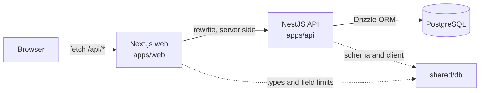

# Software Design Document

A contacts directory: a Next.js front end, a NestJS API and a PostgreSQL database, in a pnpm
workspace monorepo.

For how to run it locally, see [README.md](README.md). This document covers how it is built and
why.

## 1. Scope

The brief asks for a phone book demonstrating CRUD: a form taking a first name, a last name and a
phone number, with the ability to create, read, update and delete entries, on Next.js, NestJS and
PostgreSQL.

| Requirement | Where it is met |
| --- | --- |
| Create | `POST /contacts`, the Add contact dialog |
| Read | `GET /contacts`, the table |
| Update | `PATCH /contacts/:id`, the Edit dialog |
| Delete | `DELETE /contacts/:id` and `DELETE /contacts`, with an undoable toast |
| Next.js front end | `apps/web` |
| NestJS back end | `apps/api` |
| PostgreSQL | `shared/db`, migrations in `shared/db/drizzle/` |

Beyond the brief, the solution adds search, sorting, cursor pagination, bulk delete with undo,
optimistic writes, dark mode and containerisation. Section 6 records the reasoning; section 10
states the one limitation worth naming.

## 2. Architecture



Three components, each with one responsibility:

- **`apps/web`** renders the interface and holds no data access. It reaches the API only through
  its own `/api/*` rewrite, and never talks to the database.
- **`apps/api`** owns every read and write. It is the only process holding a database connection,
  and the only place validation and ownership are enforced.
- **`shared/db`** holds the schema, the derived types and validators, and the client factory. It is
  a library, not a service.

The split means the browser cannot reach the database, and the API needs no CORS configuration
because every request it receives is same-origin.

The stack:

| Layer | What |
| --- | --- |
| Runtime | Node 26, pnpm 12 workspaces, TypeScript 6 |
| Web | Next.js 16 App Router on Turbopack, React 19, TanStack Query 5 for server state, TanStack Table 9 for the grid, Tailwind v4, shadcn/ui on Base UI |
| API | NestJS 12 on Express, zod at the request edge, Vitest, oxlint |
| Data | PostgreSQL 18, Drizzle ORM with `drizzle-zod`, drizzle-kit migrations |

Shared dependency versions live in the `catalog:` block of `pnpm-workspace.yaml`. TypeScript is
held at 6.x on purpose: `typescript-eslint`, pulled in by `eslint-config-next`, refuses 7 and
fails `pnpm lint`.

## 3. Data model

One table. The schema lives in `shared/db/src/schema.ts` and the SQL in
`shared/db/drizzle/0000_blushing_meltdown.sql`.

| Column | Type | Notes |
| --- | --- | --- |
| `id` | `uuid` | Primary key, `gen_random_uuid()` |
| `owner_id` | `uuid` | The owning browser. Not a foreign key — see section 7 |
| `first_name` | `text` | 1–100 characters |
| `last_name` | `text` | 1–100 characters |
| `phone` | `text` | 1–32 characters, stored as entered |
| `created_at` | `timestamptz` | Defaults to `now()` |
| `updated_at` | `timestamptz` | Defaults to `now()`, refreshed on every update |

```sql
CREATE INDEX "contacts_owner_name_idx"
  ON "contacts" USING btree ("owner_id", "first_name", "last_name", "id");
```

The index is not decoration: it matches the list query's filter and sort exactly, which is what
makes pagination an index walk rather than a sort (section 6.2).

Two deliberate choices in the model:

- **The phone number is text, not a number.** Leading zeros, `+`, spaces and brackets are all
  meaningful to a person reading a phone number, and none survive a numeric type. Uniqueness is
  enforced on the digits alone (section 5).
- **There is no separate owners table.** An owner is a uuid in a cookie, so there is nothing to
  store about one. Introducing a table would suggest an account model that does not exist.

The schema is the single source of truth. Row types are derived with `typeof table.$inferSelect`,
validators with `drizzle-zod`'s `createInsertSchema`, so a column change propagates to the wire
types and the form validation without anyone restating it by hand.

## 4. API

| Method | Path | Body or query | Success |
| --- | --- | --- | --- |
| `GET` | `/health` | — | 200 |
| `GET` | `/contacts` | `limit` (1–100, default 25), `cursor`, `search` | 200 |
| `POST` | `/contacts` | `firstName`, `lastName`, `phone` | 201 |
| `PATCH` | `/contacts/:id` | any subset of those three | 200 |
| `DELETE` | `/contacts/:id` | — | 204 |
| `DELETE` | `/contacts` | `ids: string[]` (1–1000) | 204 |

A page is:

```json
{
  "items": [],
  "nextCursor": null,
  "total": 0,
  "bookTotal": 0
}
```

`total` is the size of the current match and `bookTotal` the size of the whole book; they differ
only under a search (section 6.3). `nextCursor` is opaque — a client passes it back untouched and
never constructs one.

Errors are deliberate rather than incidental:

| Status | When |
| --- | --- |
| 400 | A malformed cursor or an out-of-range `limit` |
| 404 | `PATCH` or `DELETE` on an id belonging to another browser, or to nothing |
| 409 | The number is already held by another contact in the same book |

An id belonging to another browser returns 404 rather than 403: the row is unreachable, and saying
"forbidden" would confirm it exists.

## 5. Validation

Validation runs in one place — the API — from one definition: the zod schemas derived from the
Drizzle table in `shared/db/src/schema.ts`. A `ZodPipe` applies them to query parameters and bodies,
so every route is validated before its handler runs.

Rules applied:

- Names are trimmed, non-empty, and at most `NAME_MAX` (100) characters.
- A phone number is at most `PHONE_MAX` (32) characters.
- An update must carry at least one field.
- **A phone number is unique within a book, compared by digits.** `+61 400 111 222` and
  `61400111222` are the same number, and the second is refused with 409. A contact re-saving its
  own number is not a conflict with itself, and the rule stops at the owner: a second browser may
  hold the same number.

The web client imports `NAME_MAX` and `PHONE_MAX` so the form stops typing at the same bound rather
than rejecting input after the fact, and it checks for an obvious duplicate before submitting — but
it is a fast path, not the rule. The API is the authority, and it re-checks everything.

## 6. Design decisions

Each of these had a plausible alternative. The alternative is recorded alongside the reason it was
not taken.

### 6.1 One origin, no CORS

The browser calls `/api/*` on the web server, which rewrites those requests to the API. The target
is read from `API_URL` at build time.

*Alternative:* point the browser at the API's own origin. Rejected because it requires CORS
configuration, exposes the API's address to every visitor, and makes the ownership cookie a
cross-site cookie — which browsers increasingly restrict, and which would need `SameSite=None`
plus HTTPS to work at all. Proxying keeps the cookie first-party and the API private.

### 6.2 Keyset pagination, not offset

Pages are ordered by `(first_name, last_name, id)` and the index is declared in that same order. A
page is read by resuming from the sort key of the last row sent, encoded as base64url.

*Alternative:* `LIMIT`/`OFFSET`. Rejected for two reasons. Offset degrades as the offset grows,
because the database must still walk and discard the skipped rows. Worse, it is incorrect under
concurrent writes: inserting a contact shifts every later row, so a reader paging through can see
a row twice or miss one entirely. A keyset cursor is anchored to a row that was actually seen, so
those shifts do not affect it.

The query selects one row more than it returns. The presence of that extra row answers "is there
another page?" without running a second query.

The ordering column choice matters as much as the technique: `id` is the tiebreaker, which makes
the order total. Without it, two contacts sharing a first and last name would have an ambiguous
position and could be repeated or skipped at a page boundary.

*Measured during development* against a 5,000-row book: 3.66 ms scanning and sorting, 0.11 ms
walking the index.

### 6.3 Two counts on every page

A page reports both the match (`total`) and the size of the book (`bookTotal`).

*Alternative:* report only the match. Rejected because the count then loses its context — a search
returning 12 of 340 contacts is a useful result, while "12" alone reads as a small book. Reporting
both lets the footer say `12 of 340 contacts`. The book count is only queried when a search is
active, since the two are otherwise identical.

### 6.4 Search shaped for a phone book

A search is split on whitespace and every term must match. A term matches as a prefix of a first or
last name, or as a digit sequence anywhere in the phone number.

*Alternatives:* a single substring match over the whole name, or full-text search. A substring
match on `Ada Lovelace` finds `ace` in the middle of a name, which is noise in a phone book — the
prefix rule returns only what a reader would expect. `%` and `_` are escaped before the query so
they are treated as ordinary text rather than wildcards, which would otherwise let a search for
`%` return the entire book.

Full-text search was rejected as disproportionate: it needs a generated column or a separate
index, and it tokenises on word boundaries, which does not help a phone number.

The consequence is accepted and stated: the name match is a substring comparison, which no
ordinary index can serve, so a search is a scan over the owner's rows. That is sound for a personal
phone book and would not be for a large multi-tenant directory.

### 6.5 Ownership by cookie, scoped in the database

Every contact belongs to a browser. On the first request the API mints a uuid, returns it as an
`httpOnly`, `SameSite=Lax` cookie, and scopes every read and write by it. `owner_id` never comes
from a request body or a query parameter — it is read from the cookie by a decorator, and every
statement filters on it, including the counts.

*Alternative:* no ownership at all — a single shared book. Rejected because it makes the deploy
unsafe to share: anyone reaching the URL could edit or delete anyone's contacts.

*Alternative:* real authentication. Rejected as out of scope for the brief, and unnecessary to
build the rest correctly: the table already carries `owner_id` and every query already filters by
it, so replacing `apps/api/src/owner.ts` with a real auth guard changes one file and no queries.

The honest limitation is recorded in section 10: this is identity by secret, not authentication.

### 6.6 Optimistic writes with rollback

Creates, updates and deletions apply to the cached pages before the API answers, so the table never
waits on a round trip. Server state is held by TanStack Query, which supplies the rollback.

A deletion is **hidden rather than evicted** from the cache. Eviction would be undone by the next
refetch, since the server has not yet been told; hiding keeps the row available to be restored.
That retention is also what makes the toast's Undo action possible. If a write is refused, the
pages it replaced are restored and the reason is shown.

*Alternative:* wait for the server, then update. Simpler, and correct, but every write would stall
the interface on network latency for no reason. The rollback path is small, and it is exercised by
the error branch rather than assumed.

## 7. Cross-cutting concerns

**Security.** The API holds the only database credentials; the browser never sees them. `owner_id`
is `httpOnly`, so scripts cannot read it. Every query is scoped by owner, and the scope is applied
in the service rather than trusted from the request. Response bodies omit `owner_id` entirely — an
internal identifier does not belong on the wire. There is no SQL string interpolation: all
predicates go through Drizzle or are passed as bound parameters.

`COOKIE_SECURE` exists because a `Secure` cookie is dropped by a browser over plain HTTP, which
would make every request look like a new browser. It defaults to `true` in production and is
overridable so a host without TLS can still run the stack.

**Performance.** The list query is served by an index matching its filter and sort (section 6.2).
Migrations are generated from the schema, never hand-edited, so the deployed index cannot drift
from the one the query assumes.

**Accessibility.** Form fields are real `<label>`-associated inputs with `aria-invalid` and
`aria-describedby` pointing at their error text, so a failure is announced rather than only
coloured. The sortable headers are `<button>`s, the selection bar is marked `inert` while hidden so
its controls are not focusable, and icon-only controls carry `aria-label`. Motion respects
`prefers-reduced-motion`.

**Errors.** A failure to load the book offers a retry panel; a failure to load a later page shows a
toast rather than discarding the pages already held. A refused write restores what it replaced and
reports the server's own message, so a 409 explains itself.

## 8. Testing

`pnpm test` runs unit tests; `pnpm test:e2e` runs the API against a real PostgreSQL instance.

The unit suite covers the health endpoint. The end-to-end suite is where the behaviour is pinned,
because the interesting failures are all interactions with the database:

- a contact round-trips through create, read, update and delete
- a bulk delete ignores ids belonging to another browser
- a book pages through by cursor, and a malformed cursor is refused
- search matches names and numbers, and reports both counts
- a number already in the book is refused however it is written
- one browser cannot reach another browser's book
- the health endpoint answers

Testing against a real database rather than a mock is deliberate: cursor pagination, index-backed
ordering and the digit comparison are all database behaviour. A mock would test the mock.

## 9. Deployment

Two Docker images, both built from the repository root because a per-app context cannot see the
workspace lockfile or `shared/*`.

| Image | How it is built | How it runs |
| --- | --- | --- |
| `apps/api` | `pnpm build:shared`, `nest build`, then `pnpm deploy --prod --legacy` to produce a self-contained bundle | `node dist/main.js` |
| `apps/web` | `pnpm build:shared`, then `next build` with `output: "standalone"` | `node apps/web/server.js` |

Both compile `shared/db` before their own build: it ships `dist/` only, `.dockerignore` keeps the
local `dist/` out of the build context, and the field limits are imported as values rather than
types, so the package must exist at build time.

`docker compose up -d` starts PostgreSQL alone — the only dependency local development needs. The
api and web services sit behind an `app` profile so they do not contend with `pnpm dev` for ports.
Both the database and the API define healthchecks, and the web service waits on the API's.

## 10. Limitations

**Identity is not authentication.** The `owner_id` cookie is a bearer secret. There is no password,
no account recovery, no revocation, and clearing cookies starts a new book. It keeps one browser's
contacts away from another's, which is what the brief needs; it is not a security boundary against
a determined party, and it should not be described as one. The upgrade path is narrow by design —
`apps/api/src/owner.ts` is the only file that would change.
